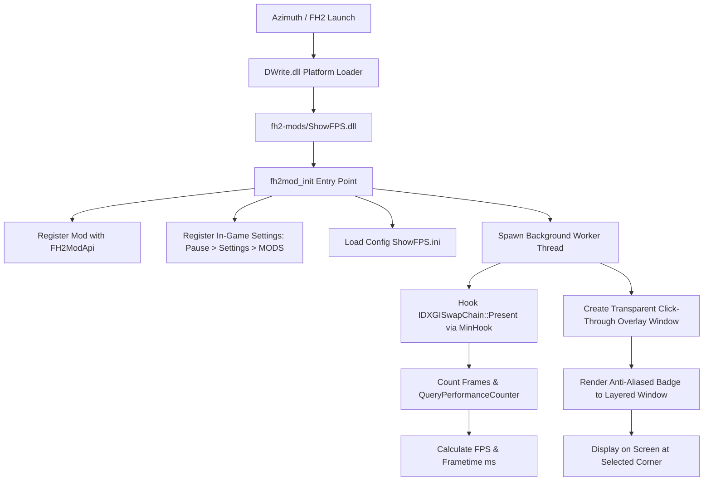

# ShowFPS

A real-time, hardware-accurate in-game FPS and frametime overlay mod for **Forza Horizon 2** on PC, built on the [FH2 Mod Platform](https://github.com/Trinculo54/fh2-mod-platform) for the Azimuth compatibility layer.


---

## Features

- **Real-Time FPS & GPU Utilization:** Displays current framerate alongside real-time GPU load percentage in the modern gaming format (e.g. `60 GPU:84%`).
- **Universal GPU Support:** Combines high-speed NVML (NVIDIA) with universal Windows Performance Counters (PDH) fallback for AMD Radeon, Intel Arc, and integrated GPUs.
- **Hardware-Accurate Timing:** Hooks directly into `IDXGISwapChain::Present` and `IDXGISwapChain1::Present1` using the platform's MinHook integration, measuring exact delta times and frame rates between GPU presentation calls.
- **Customizable HUD Layout:** Tight, modern margins placed right against the screen border so it sits neatly out of the way of the in-game CR counter and HUD elements.
- **Background Pill or Transparent Text:** Option to show a translucent rounded pill badge or pure text with a crisp dark outline.
- **Customizable Font Size & Text Colors:** Choose between font sizes (12px to 32px) and text colors (Pure White, Emerald Green, Amber Gold, Cyan, Coral Red, or Dynamic color by framerate).
- **In-Game Settings Integration:** Seamlessly integrated into the game's native menu under **Pause > Settings > MODS**:
  - **Show FPS Counter:** Toggle overlay visibility
  - **Show GPU Usage (%):** Toggle GPU load percentage display (e.g. `60 GPU:84%`)
  - **Show Frame Time (ms):** Display frametime next to FPS (e.g. `60 GPU:84%  16.6 ms`)
  - **Show Background Box:** Toggle background box on/off (off = text with outline only)
  - **Font Size (Slider):** Adjust overlay text size from 12 to 32 pixels
  - **Text Color Preset (Slider):** 0=White, 1=Green, 2=Yellow, 3=Cyan, 4=Red
  - **Dynamic Color by FPS:** Color text by framerate ($\ge$ 50 Green, 30–49 Yellow, < 30 Red)
  - **Corner Position:** Switch between Top-Right and Top-Left
  - **Detailed Decimal FPS:** Toggle integer vs. decimal precision (e.g. `59.8 GPU:84%`)
- **Quick Hotkey:** Press **F11** anytime while driving to toggle the overlay on and off instantly.
- **Zero Input Interference:** Built with a high-performance transparent layered window (`WS_EX_TRANSPARENT | WS_EX_LAYERED | WS_EX_NOACTIVATE`) that passes all mouse, keyboard, and controller inputs directly to the game.
- **Auto-Hiding:** Automatically pauses and hides when the game is minimized or when you Alt+Tab out of the game window.
- **Persistent Configuration:** Saved in `ShowFPS\ShowFPS.ini` next to `azimuth.exe`.

---

## Installation

1. Download or build the release files.
2. Extract the files into your **Azimuth** game folder (the folder containing `azimuth.exe`):

```text
azimuth.exe
DWrite.dll                  <-- The FH2 Mod Platform
fh2-mods/
  ShowFPS.dll               <-- The ShowFPS mod DLL
  ShowFPS.ini               <-- Configuration file (together with the DLL)
LICENSE-MinHook.txt
```

3. Launch the game through Azimuth. The FPS counter will appear in the top-right corner.
4. Press **F11** to toggle the counter at any time, or configure options under **Pause > Settings > MODS**.

---

## Configuration (`ShowFPS.ini`)

Settings can be changed either via the in-game **MODS** menu or by editing `fh2-mods\ShowFPS.ini`:

```ini
[ShowFPS]
; 1 = Show overlay, 0 = Hide overlay
Enabled=1

; 1 = Show GPU utilization percentage (e.g. 60 GPU:84%), 0 = Hide GPU usage
ShowGpuUsage=1

; 1 = Show frametime in ms, 0 = Hide frametime
ShowFrameTime=0

; 1 = Show translucent background pill, 0 = Text with outline only (no background box)
ShowBackground=1

; Corner Position: 0 = Top-Left, 1 = Top-Right, 2 = Bottom-Right, 3 = Bottom-Left
Position=1

; 1 = Decimal FPS (e.g., 59.8 FPS), 0 = Integer FPS (e.g., 60 FPS)
Detailed=0

; Text Color Preset: 0=White, 1=Green, 2=Yellow, 3=Cyan, 4=Red, 5=Dynamic
TextColorPreset=0

; 1 = Color text dynamically based on FPS, 0 = Use preset color
DynamicColor=0

; Font size in pixels (default 16, range 12 to 32)
FontSize=16

; Distance from screen border in pixels
MarginX=8
MarginY=6

; Background pill opacity (0 = transparent to 255 = solid, default 220)
BgAlpha=220

; Update interval in milliseconds (default 250 ms)
UpdateIntervalMs=250

; Virtual Key Code for toggle hotkey (122 = 0x7A = VK_F11)
ToggleHotkey=122
```

---

## Building from Source

### Prerequisites

- **CMake** 3.20 or newer
- **Visual Studio 2022** (with "Desktop development with C++") or **llvm-mingw**
- Git

### Build Instructions

```powershell
# Clone with submodules (for the FH2 Mod Platform)
git clone --recurse-submodules https://github.com/BartholomewHo/ShowFPS.git
cd ShowFPS

# Configure build
cmake -B build -G "Visual Studio 17 2022" -A x64

# Build Release binary and package distribution
cmake --build build --config Release --target dist
```

After building, the ready-to-use release folder is located in `build/dist/`.

---

## Architecture Overview



---

## License

Released under the [MIT License](LICENSE).  
Includes [MinHook](https://github.com/TsudaKageyu/minhook) by Tsuda Kageyu, licensed under the BSD 2-Clause License (see `LICENSE-MinHook.txt`).
